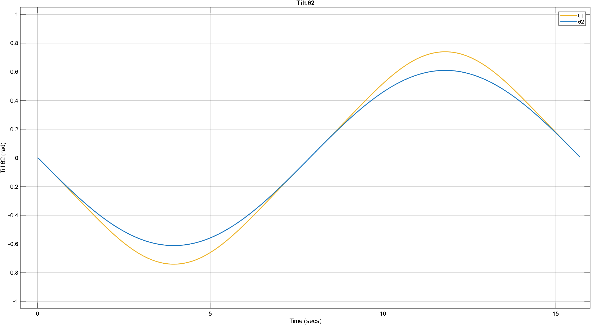
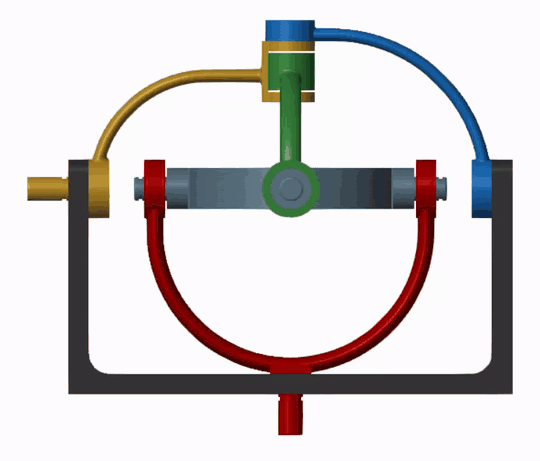

# Spherical Parallel Mechanism

Term Project 2569 · 2103-322 Design of Mechanism

## Getting started

1. Start with **Symbolic Math** for the mechanism diagram, equations, and plots. Then see **Simscape Multibody** for the 3D simulation and **Physical prototype** for the built mechanism.
2. To run the model, select **Code → Download ZIP** on GitHub and extract the files.
3. In MATLAB R2026a, with Simulink, Simscape, and Simscape Multibody installed, set the **Current Folder** to `simulation/`. Open `SPM_allR.slx` and click **Run**. The model loads `spm_params.m` automatically.

## Project overview

- **Project name** — Spherical Parallel Mechanism for Pan–Tilt Motion
- **Problem / purpose**

  Because the sun’s position changes throughout the day and across seasons, a solar panel fixed at one tilt angle receives sunlight at a certain angle, which reduces the energy it collects. A panel that can rotate about both a pan and a tilt axis can keep facing the sun and generate more energy. The purpose of this project is to model, simulate and build a prototype of a 2-DOF spherical parallel mechanism that orients a solar panel in pan and tilt, keeping both inputs on the fixed base. A symbolic kinematic model is used to predict the panel’s orientation from the two input angles and to check its range of motion and singular positions, providing a basis for a future sun-tracking system.
- **Team**
  - Jinjuta Peecharsoontorn 6730069121, Symbolic Math
  - Pavida Mayudee 6730413321, Simscape Multibody
  - Name, Physical Prototype
- **Status** — Simscape model and demonstration videos uploaded
- **Last updated** — 2026-11-19

### Motivation

For this project, we had to choose a mechanism and explain how its input motion produces its output motion. We chose a pan–tilt mechanism and used a solar panel as an example. During the day, the sun changes both its direction along the horizon and its height above it. To keep a panel facing the sun, we need to turn it side to side (pan) and angle it up or down (tilt).

What we wanted to find out was how much the platform pans and tilts when we turn the two input joints, J1 and J3. We used kinematic equations to relate the input angles to the platform angles, then built a Simscape Multibody model to see how the links move together.

### Symbolic Math

#### Kinematic analysis

<!-- Add the mechanism diagram, link and joint labels, degree-of-freedom calculation, and kinematic equations here. -->

#### Results and plots

<!-- Add the plots here. Label the axes and units, and state the joint inputs used for each case. -->

#### Symbolic simulation

<!-- Add images or videos from the symbolic simulation and a link to the MATLAB Live Script here. -->

### Simscape Multibody

#### Simscape Model

The model takes joint-angle inputs at J1 and J3 and measures the platform's pan and tilt angles.

#### Pan and Tilt Results

| Platform Pan | Platform Tilt and J3 Angle |
| :---: | :---: |
|  |  |

The horizontal axis shows time in seconds, and the vertical axis shows angle in radians. In the right plot, the yellow trace is platform tilt and the blue trace is the measured J3 angle (θ₂).

The model uses CAD parts connected by five revolute joints (J1–J5). We applied sinusoidal angle inputs at J1 and J3. The other three joints move as the links guide the platform. In the simulation shown here, the input angles vary between ±40° at J1 and ±35° at J3. Both input signals have an angular frequency of 0.4 rad/s.

### Joint Sweep Tests

Both tests start at Position A, with J1 at 0° and J3 at +90°. One joint moves at a time while the other stays fixed.

#### J1 Sweep on Top View

The red link rotates back and forth about J1 while J3 is held at +90°.

[Watch the J1 sweep (MP4)](media/j1_sweep_top.mp4)

#### J3 Sweep on Isometric View

The yellow link rotates back and forth about J3 while J1 is held at 0°.

[Watch the J3 sweep (MP4)](media/j3sweep_iso.mp4)

| File | Description |
| --- | --- |
| [Mechanism.avi](media/Mechanism.avi) | Demonstration video for submission |
| [Render.jpg](media/Render.jpg) | Still image of the mechanism from the isometric view |
| [Isometric](media/iso.mp4) · [Top](media/Top.mp4) · [Left](media/left.mp4) | Simulation videos from three views |
| [SPM_allR.slx](simulation/SPM_allR.slx) | Simscape Multibody model |
| [spm_params.m](simulation/spm_params.m) | Joint locations and simulation parameters |
| [CAD files](simulation/cad/) | Part geometry used in the model |

After running the model, open **Scope pan** to see the platform pan angle over time. Open **Scope tilt,θ2** to compare the platform tilt and the measured angle at J3 on the same time axis. If the model cannot find a CAD file, check the **File Name** field in the corresponding File Solid block. It should point to a file in `cad/`, such as `cad/Frame.step`.

[MathWorks documentation for the File Solid block](https://www.mathworks.com/help/sm/ref/filesolid.html)

### Physical prototype

<!-- Add photos or a video of the prototype here. Show how pan and tilt are adjusted and describe what you observed during testing. -->

## Repository structure

| Path | Purpose |
| --- | --- |
| `hardware/mechanical/` | CAD models, drawings, and fabrication files |
| `simulation/` | Models, scripts, assumptions, and simulation results |
| `docs/` | Assembly, setup, operation, and maintenance instructions |
| `media/` | Images, GIFs, and links to demonstration videos |
| `publications/` | Project-related journal and conference papers |
