# 2-DOF Spherical Parallel Mechanism

Term Project 2569 · 2103-322 Design of Mechanism

| Path | Purpose |
| --- | --- |
| `hardware` | CAD models |
| `simulation/Simscape Multibody` | Simscape Multibody files |
| `simulation/Symbolic Mathematics` | Symbolic Math scripts |
| `media/` | Images, GIFs, and links to demonstration videos |
| `publications/` | Project-related journal and conference papers |

## Project overview

- **Project name** — 2-DOF Spherical Parallel Mechanism for Pan–Tilt Motion
- **Problem / purpose**

Because the sun’s position changes throughout the day and across seasons, a solar panel fixed at one tilt angle receives sunlight at a certain angle, which reduces the energy it collects. A panel that can rotate about both a pan and a tilt axis can keep facing the sun and generate more energy. The purpose of this project is to model, simulate and build a prototype of a 2-DOF spherical parallel mechanism that orients a solar panel in pan and tilt, keeping both inputs on the fixed base. A symbolic kinematic model is used to predict the panel’s orientation from the two input angles and to check its range of motion and singular positions, providing a basis for a future sun-tracking system.
- **Team**: ริ๋มตั๊ก
  - Jinjuta Peecharsoontorn 6730069121
  - Pavida Mayudee 6730413321
  - Puntira Chatthammarak 6730400121
- **Status** — Finish
- **Last updated** — 2026-11-20

## Motivation

For this project, we had to choose a mechanism and explain how its input motion produces its output motion. We chose a pan–tilt mechanism and used a solar panel as an example. During the day, the sun changes both its direction along the horizon and its height above it. To keep a panel facing the sun, we need to turn it side to side (pan) and angle it up or down (tilt).

What we wanted to find out was how much the platform pans and tilts when we turn the two input joints, J1 and J3. We used kinematic equations to relate the input angles to the platform angles, then built a Simscape Multibody model to see how the links move together.

## Kinematic Diagram and DOF Analysis

### Kinematic Schematic & Spherical Architecture

<p align="center">
  
</p>

- **System Topology:** A closed-loop 2-DOF **Spherical Parallel Manipulator (SPM)** comprising **$L = 5$ rigid links** (`Link 1`–`Link 5`) connected by **$J = 5$ single-DOF revolute joints** (`a`, `b`, `c`, `d`, `e`, with zero higher-pair joints $J_2 = 0$).
- **Common Center of Rotation:** As shown by the dashed blue centerlines, the rotation axes of all five revolute joints intersect at a single stationary point—the **center of rotation** located at $O = (0, 0, 0)$. This geometric condition constrains every moving link to concentric spherical surfaces, ensuring the central platform (`Link 5`) exhibits pure 2-DOF spherical orientation with zero linear velocity at the center ($v_O = 0$).
- **Parallel Kinematic Chains (`RR` and `RRR` Limbs):**
  - **Lower `RR` Limb (`e` $\rightarrow$ `d`):** The first active input at base joint `e` ($\theta_1$) rotates the lower red curved yoke (`Link 2`) about the vertical $Y$-axis, directly guiding the central ring (`Link 5`) via passive joint `d`.
  - **Upper `RRR` Limb (`a` $\rightarrow$ `b` $\rightarrow$ `c`):** The second active input at coaxial base joint `a` ($\theta_2$) pivots the upper yellow arch (`Link 4`) about the horizontal $X$-axis, transmitting rotational motion through the intermediate green coupler (`Link 3`) via passive joints `b` and `c`.
- **Orthogonal Span Geometry:** Adjacent revolute joint axes on each link are arranged at orthogonal ($90^\circ$) angular spans, maintaining constant spherical pivot radii and decoupled pan-tilt actuation across the operating range.

### Degree-of-Freedom (DOF) & Over-Constrained Paradox

- **General 3D Spatial Mobility (Negative Result):** In 3D Euclidean space ($d = 6$), applying the standard **Chebyshev–Grübler–Kutzbach criterion** to this 5-link, 5-revolute-joint ($f_i = 1$) closed loop yields a negative mobility value, mathematically predicting a statically indeterminate, locked structure:

$$\text{DOF}_{\text{spatial}} = 6(L - 1) - \sum_{i=1}^{J} (6 - f_i) = 6(5 - 1) - 5(6 - 1) = 24 - 25 = -1$$

- **Kinematic Paradox Resolution ($+3$ Redundant Constraints):** The standard spatial formula assumes all joint constraints act independently. However, because all five revolute axes converge at the common **center of rotation** $O = (0, 0, 0)$, both the `RR` and `RRR` limbs independently restrict translational motion along the $X, Y,$ and $Z$ axes. This introduces **$c = 3$ redundant geometric constraints**, classifying the mechanism as an **over-constrained spherical manipulator** whose true mobility is resolved via the **Modified Grübler–Kutzbach equation** (and verified by the spherical mobility relation $d = 3$):

$$\text{DOF}_{\text{modified}} = 6(L - 1) - \sum_{i=1}^{J} (6 - f_i) + c = -1 + 3 = \mathbf{2}$$

$$\text{DOF}_{\text{spherical}} = 3(L - 1) - 2J = 3(5 - 1) - 2(5) = \mathbf{2}$$

- **Physical Mobility in Hardware (Clearances & Compliance):** Theoretically, an over-constrained linkage requires exact manufacturing alignment of all joint axes at $O = (0, 0, 0)$ to prevent mechanical binding. In the physical SLS 3D-printed prototype (Nylon 12), small **radial and axial bearing clearances** at joints `a`–`e` combined with the **elastic structural compliance** of the curved polymer links (`Link 2`–`Link 4`) naturally absorb minor geometric tolerances, enabling smooth, lock-free 2-DOF motion.

### Orientation Workspace & Singularity Analysis

- **Spherical Orientation Envelope:** With zero translational displacement ($\Delta x = \Delta y = \Delta z = 0$), the end-effector sweeps a bounded spherical orientation cone under the simulated sinusoidal trajectories $\theta_1(t) = 40^\circ \sin(0.4t)$ at joint `e` and $\theta_2(t) = -35^\circ \sin(0.4t)$ at joint `a` over one full period ($T = 15.708\text{ s}$):

| Parameter / Joint | Angular Range (rad) | Angular Range (deg) | Peak Velocity | Peak Acceleration | Kinematic Role |
| :--- | :---: | :---: | :---: | :---: | :--- |
| **Base Input `e` ($\theta_1$ / Pan)** | $\pm 0.6981\text{ rad}$ | $\pm 40.00^\circ$ | $0.2793\text{ rad/s}$ | $0.1117\text{ rad/s}^2$ | Primary azimuthal rotation ($Y$-axis) |
| **Base Input `a` ($\theta_2$)** | $\pm 0.6109\text{ rad}$ | $\pm 35.00^\circ$ | $0.2443\text{ rad/s}$ | $0.0977\text{ rad/s}^2$ | Secondary drive (`RRR` limb, $X$-axis) |
| **Passive Joint `d` (Tilt Output)** | $\pm 0.7405\text{ rad}$ | $\pm 42.43^\circ$ | $0.2498\text{ rad/s}$ | $0.1503\text{ rad/s}^2$ | Coupled platform elevation ($X$-axis) |
| **Passive Joint `b` (`Link 4–3`)** | $0 \text{ to } 0.4486\text{ rad}$ | $0^\circ \text{ to } 25.70^\circ$ | — | — | Intermediate `RRR` coupler articulation |
| **Passive Joint `c` (`Link 3–5`)** | $\pm 0.5545\text{ rad}$ | $\pm 31.77^\circ$ | — | — | Platform spherical constraint ($Y$-axis) |

- **Tilt Amplification & Physical Limits:** Due to non-linear spherical coupling between the two limbs, a $\pm 35.00^\circ$ input sweep at joint `a` produces an amplified **$\pm 42.43^\circ$** ($0.7405\text{ rad}$) output tilt at passive joint `d` in simulation. In the physical assembly, mechanical clearance against the U-shaped ground frame (`Link 1`) bounds the safe operating sweep to approximately **$\pm 34^\circ$–$40^\circ$**.
- **Singularity-Free Operation:** Across the entire simulated workspace, the Jacobian determinant remains strictly bounded within **$1.000 \le \det(\mathbf{J}) \le 1.0858$**. Because $\det(\mathbf{J})$ stays close to unity and never approaches zero, the mechanism operates entirely within a **high-dexterity, singularity-free zone** with uniform torque transmission and no self-motion configurations.

## Symbolic Math
**Requirements**
- MATLAB (developed in R2026a; R2016b or newer should work)
- Symbolic Math Toolbox
  
**How to run**
1. Open [Symbolic_Math_v6_2.mlX](simulation/Symbolic%20Mathematics/Symbolic_Math_v6_2.mlx) in MATLAB. 
2. Adjust the settings in section 0 if needed.
3. Click Run All.

The live script is organised in sections:

| Section | Content |
| --- | --- |
| 0 | Settings |
| 1 | Parameters |
| 2 | Mechanism details and DOF calculation |
| 3 | Symbolic kinematics |
| 4 | Symbolic Jacobian, velocity and acceleration |
| 5 | Summary table |
| 6 | Graphs |
| 7 | Animation |

Comments were provided inside the script for better understanding of its function.

**Symbolic Math overview**

The panel is held by two kinematic chains that both start on the fixed base. Two input angles are applied at the base:
- θ1 at joint J1, which pans the panel
- θ2 at joint J3, which tilts the panel through the second leg
- The two chains are:
  - Chain e–d: Link 1(ground) → e → Link 2 (red) → d → Link 5 (panel, grey)
  - Chain a–b–c: Link 1 → a → Link 4 (yellow) → b → Link 3 (green) → c → Link 5 (panel, grey)

### Kinematic analysis
**Mechanism**

All joints are revolute, and every joint axis passes through the centre point O = (0, 0, 0), which makes this a spherical mechanism. The Y axis points up

| Joint | Connects | Axis | Point on axis (mm) | Role |
| --- | --- | --- | --- | --- |
| a | Link 1 – Link 4 | X | (−49, 0, 0) | active, θ2 |
| b | Link 4 – Link 3 | Z |	(0, 0, −30) | passive |
| c | Link 3 – Link 5 | Y |	(0, 25, 0)| passive |
| d | Link 5 – Link 2 | X |	(30, 0, 0) | passive (= tilt) |
| e | Link 1 – Link 2 | Y |	(0, −45, 0) | active, θ1 (pan) |

The inputs are

```math
\theta_1(t) = A_1 \sin(\omega_1 t), \qquad \theta_2(t) = A_2 \sin(\omega_2 t)
```

| Variable | Meaning | Value |
| --- | --- | --- |
| A1, A2 | Input amplitudes, entered in degrees and converted to rad | 40°, −35° |
| w1, w2 | Input frequencies (rad/s) | 0.4, 0.4 |
| t | Simulation time, one full period | 15.708 s |

**Degrees of freedom**


$$DOF = 3(n - 1) - 2j_1 - j_2$$

- n = 5 links (base, Link2, Link4+5, Link3, platform)
- j1 = 5 full joints (J1–J5, all revolute)
- j2 = 0 half joints


$$DOF=3(5-1)-2(5)-0=2$$

This confirms θ1 and θ2 are the inputs.

### Symbolic Kinemnatics
The angles of the passive joints b, c and d are named `qb`, `qc` and `qd` in the code. Each leg gives the platform orientation as a product of rotations:

$$R_1 = R_y(\theta_1)\,R_x(q_d), \qquad R_2 = R_x(\theta_2)\,R_z(q_b)\,R_y(q_c)$$

Loop closure. Link 3 keeps the axis of joint b perpendicular to the axis of joint c:

$$\mathbf{u}_b \cdot \mathbf{u}_c = 0, \qquad \mathbf{u}_b = R_x(\theta_2)\,\hat{z}, \quad \mathbf{u}_c = R_1\,\hat{y}$$

which gives

$$\cos\theta_1 \cos\theta_2 \sin q_d - \sin\theta_2 \cos q_d = 0 \quad\Rightarrow\quad \tan q_d = \frac{\tan\theta_2}{\cos\theta_1}$$

Pan and tilt (assembly branch with cos q_d > 0):

$$\text{pan} = \theta_1, \text{tilt} = q_d = {arctan2}(\sin\theta_2,\ \cos\theta_1\cos\theta_2)$$

These follow from the platform rotation matrix R: pan = atan2(R13, R33) and tilt = atan2(−R23, R22).

Passive joints of chain a–b–c, from

$$M = R_x(\theta_2)^T R_1 = R_z(q_b)\,R_y(q_c)$$

$$q_b = {atan2}(-M_{12},\ M_{22}), \qquad q_c = {atan2}(-M_{31},\ M_{33})$$

**Velocity, acceleration and singularity**
Velocities and accelerations are found by differentiating pan(t) and tilt(t) symbolically with `diff`.The Jacobian relates input rates to output rates:

```math
$$\begin{bmatrix}\dot{\text{pan}} \\ \dot{\text{tilt}}\end{bmatrix} = J \begin{bmatrix}\dot\theta_1 \\ \dot\theta_2\end{bmatrix}, \qquad
J = \begin{bmatrix} 1 & 0 \\ \dfrac{\partial\,\text{tilt}}{\partial\theta_1} & \dfrac{\partial\,\text{tilt}}{\partial\theta_2} \end{bmatrix}$$
```

$$\det J = \frac{\cos\theta_1}{\cos^2\theta_1\cos^2\theta_2 + \sin^2\theta_2}$$

- det J = 1: tilt changes one-to-one with θ2 (this is the case at θ1 = 0).
- det J → 0 at |θ1| = π/2: a singularity. There θ2 no longer changes the tilt, so the panel can't be controlled in that direction.
  - With A1 = 40°, θ1 never gets near π/2. Over the whole motion det J stays between 1.000 and 1.0858, so the mechanism stays well away from the singularity.
  
### Results 
**Summary Table**

| Parameter | Value |
| --- | --- |
| max pan | 0.6981 rad |
| max tilt | 0.7405 rad |
| max pan velocity | 0.2793 rad/s |
| max tilt velocity | 0.2498 rad/s |
| max pan acceleration | 0.1117 rad/s² |
| max tilt acceleration | 0.1503 rad/s² |
| J2 range (= tilt) | ±0.7405 rad |
| J4 range | 0 to 0.4486 rad |
| J5 range | ±0.5545 rad |
| det J range | 1.000 to 1.0858 | 

**Figures**
| Figure | Descrption |
| --- | --- |
| Input angle | θ1 and θ2 vs time |
| Pan & Tilt | Pan vs time; tilt vs time with θ2 for comparison |
| Velocity & Acceleration | Pan and tilt rates and accelerations |
| Passive joints |	Angles of d (= tilt), b and c vs time |
| Pan-tilt path | Tilt vs pan: the directions the panel points during the motion |

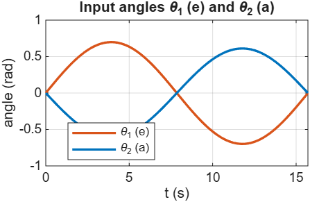

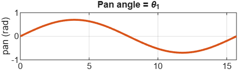 

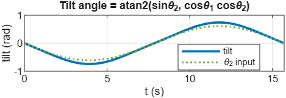

|  |  |
| :---: | :---: |
| 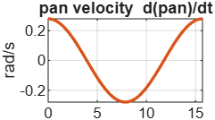 | 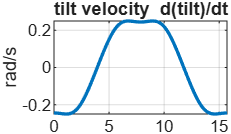 
| 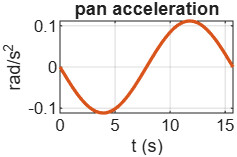 | 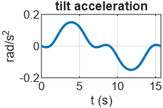 |

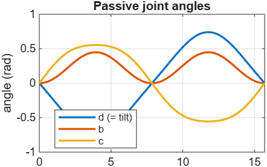

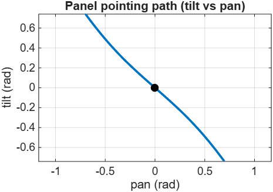

**Symbolic simulation**

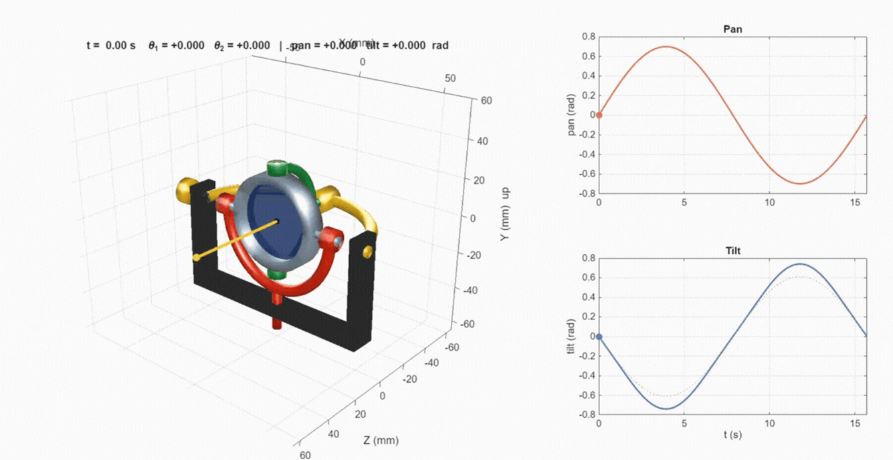

**Limitations**
- The animation uses simplified shapes (arcs, rings and pins) sized from the CAD parts, not the CAD geometry itself.
- Kinematics only: masses, gravity and joint torques are not modelled.

## Simscape Multibody

For the proposed solar-tracking application, the platform must be able to change its orientation in both pan and tilt. The Simscape Multibody model relates these platform angles to the rotation of the two actuated joints at the base.


#### Model Configuration

The fixed base and moving platform are connected by two chains of rigid bodies that form a closed-loop mechanism with five revolute joints. Angular motion is prescribed at joint **e** (θ₁, previously J1) and joint **a** (θ₂, previously J3). The passive joints **b**, **c**, and **d** move according to the linkage constraints. The platform orientation is measured relative to the fixed base and expressed as pan and tilt.

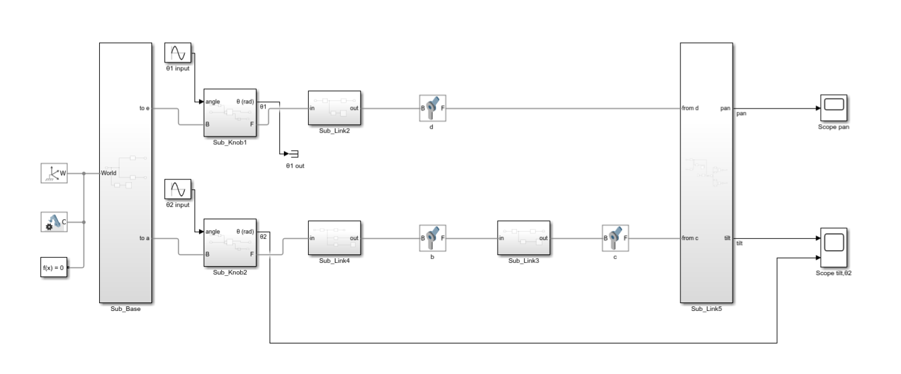

#### Platform Response Under Combined Inputs

Joints **e** and **a** were driven simultaneously with sinusoidal angle commands. The amplitudes were 0.698 rad (40°) at joint **e** and 0.611 rad (35°) at joint **a**. Both commands had an angular frequency of 0.4 rad/s, corresponding to a period of approximately 15.7 s. The plots show one cycle, with time in seconds and angles in radians.

| Platform Pan | Platform Tilt and Measured Joint a Angle |
| :---: | :---: |
| 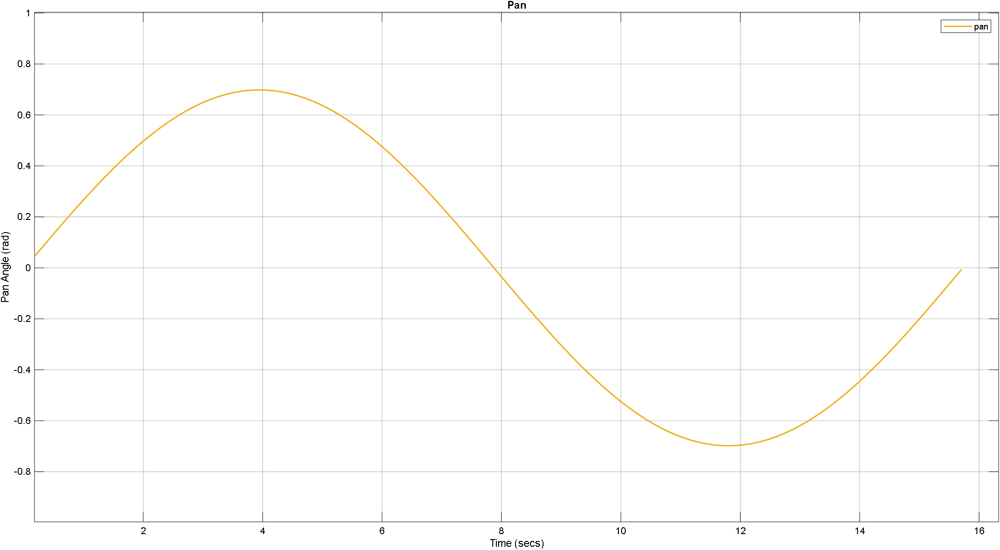 |  |

The platform pan amplitude was approximately 0.70 rad, close to the commanded amplitude at joint **e**. In the right plot, the platform tilt (yellow) reached an amplitude of approximately 0.74 rad, compared with 0.61 rad for the measured angle at joint **a** (blue, θ₂). The difference in amplitude was approximately 0.13 rad for this test.

#### Single-Joint Sweep Tests

The combined-input simulation quantifies the platform response when both inputs are active. The sweeps below show how the linkage and platform move when each input is varied separately. Both tests started with joint **e** at 0° and joint **a** at +90°. In each test, one joint was swept while the other was held at its starting angle.

| Joint e Sweep — Top View | Joint a Sweep — Isometric View |
| :---: | :---: |
| 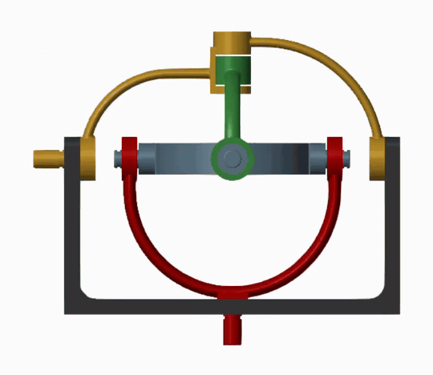 | 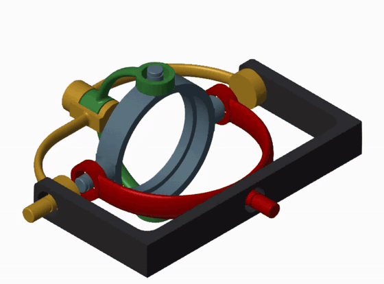 |
| Joint **a** was held at +90°. The top view shows the platform turning relative to the base. | Joint **e** was held at 0°. The isometric view shows the change in platform inclination. |
| [MP4](media/jointesweep.mp4) | [MP4](media/jointasweep.mp4) |

#### Reproducing the Combined-Input Simulation

1. Download and extract the repository. Open MATLAB with Simulink, Simscape, and Simscape Multibody installed.
2. Set the MATLAB Current Folder to `simulation/Simscape Multibody/`. Open `SPM_allR.slx` and click **Run**.
3. Open **Scope pan** to view the platform pan angle, then open **Scope tilt,θ2** to compare the platform tilt with the measured angle at joint **a**.

| File | Description |
| --- | --- |
| [SPM_allR.slx](simulation/Simscape%20Multibody/SPM_allR.slx) | Simscape Multibody model |
| [spm_params.m](simulation/Simscape%20Multibody/spm_params.m) | Model geometry and input parameters |
| [CAD files](simulation/Simscape%20Multibody/cad/) | Geometry of the rigid bodies |
| [Combined-input simulation (MP4)](media/iso.mp4) · [AVI](media/iso.avi) | Isometric recording with both joints driven |
| [Render.jpg](media/Render.jpg) | Isometric render of the mechanism |

## Physical prototype

3D CAD assembly of the 2-DOF Spherical Parallel Mechanism modeled in Autodesk Fusion 360, illustrating the neutral home configuration, single-axis actuation at joint `a`, and bidirectional base rotation sweeps at joint `e`:

| Neutral Pose | Joint `a` Sweep | Joint `e` Sweep ($+34^\circ$) | Joint `e` Sweep ($-34^\circ$) |
| :---: | :---: | :---: | :---: |
|  |  |  |  |

#### SLS 3D-Printed Prototype Testing (Formlabs Fuse / Nylon 12)

Manual actuation tests were conducted by rotating the two base input axes to verify the motion of the central ring:

| State 1 | State 2 | State 3 |
| :---: | :---: | :---: |
|  |  |  |

| State 4 | State 5 |
| :---: | :---: |
|  |  |

#### Physical Prototype Demonstration Video

The SLS 3D-printed prototype was manually actuated to demonstrate the conversion of two independent base rotations (J1 and J3) into pure 2-DOF spherical orientation of the central platform.

The demonstration animation illustrates the smooth, coordinated motion of the assembled mechanism, confirming that all five revolute joint axes remain aligned with the central Remote Center of Motion (RCM) without link interference or binding across the tested workspace.

Despite these physical tolerances, the prototype successfully validates the kinematic behavior and smooth spherical mobility of the 2-DOF Spherical Parallel Mechanism within its functional operating range.


