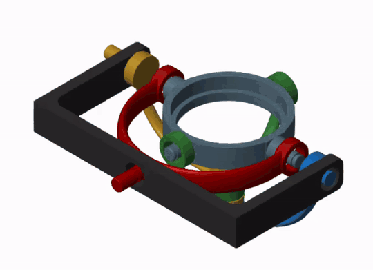
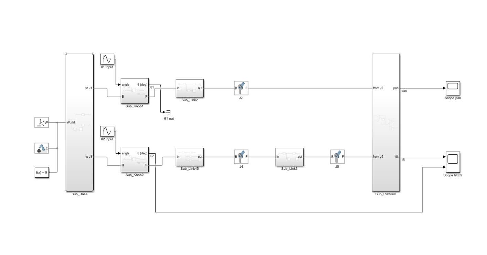
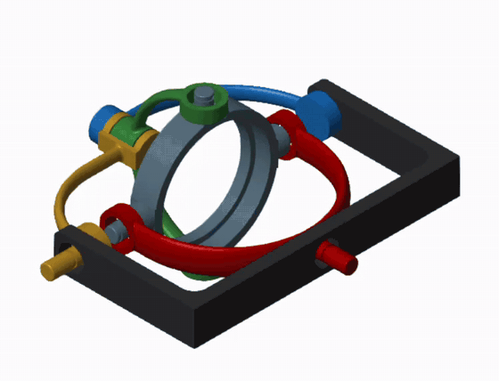

# 2-DOF Spherical Parallel Mechanism

Term Project 2569 · 2103-322 Design of Mechanism

## Repository structure

| Path | Purpose |
| --- | --- |
| `hardware/mechanical/` | CAD models, drawings, and fabrication files |
| `simulation/` | Models, scripts, assumptions, and simulation results |
| `docs/` | Assembly, setup, operation, and maintenance instructions |
| `media/` | Images, GIFs, and links to demonstration videos |
| `publications/` | Project-related journal and conference papers |

## Project overview

- **Project name** — 2-DOF Spherical Parallel Mechanism for Pan–Tilt Motion
- **Problem / purpose**

  Because the sun’s position changes throughout the day and across seasons, a solar panel fixed at one tilt angle receives sunlight at a certain angle, which reduces the energy it collects. A panel that can rotate about both a pan and a tilt axis can keep facing the sun and generate more energy. The purpose of this project is to model, simulate and build a prototype of a 2-DOF spherical parallel mechanism that orients a solar panel in pan and tilt, keeping both inputs on the fixed base. A symbolic kinematic model is used to predict the panel’s orientation from the two input angles and to check its range of motion and singular positions, providing a basis for a future sun-tracking system.
- **Team**: ริ๋มตั๊ก
  - Jinjuta Peecharsoontorn 6730069121
  - Pavida Mayudee 6730413321
  - Puntira Chatthammarak 6730400121
- **Status** — Finish
- **Last updated** — 2026-11-19

## Motivation

For this project, we had to choose a mechanism and explain how its input motion produces its output motion. We chose a pan–tilt mechanism and used a solar panel as an example. During the day, the sun changes both its direction along the horizon and its height above it. To keep a panel facing the sun, we need to turn it side to side (pan) and angle it up or down (tilt).

What we wanted to find out was how much the platform pans and tilts when we turn the two input joints, J1 and J3. We used kinematic equations to relate the input angles to the platform angles, then built a Simscape Multibody model to see how the links move together.

## Symbolic Math

#### Symbolic Math overview
The panel is held by two kinematic chains (legs) that both start on the fixed base. Two input angles are applied at the base:
- θ1 at joint J1, which pans the panel
- θ2 at joint J3, which tilts the panel through the second leg
  
#### Requirements
- MATLAB (developed in R2026a; R2016b or newer should work)
- Symbolic Math Toolbox
  
#### How to run
1. Open Symbolic_Math_v6_1.mlx in MATLAB.
2. Adjust the settings in section 0 if needed (see below).
3. Click Run All.

The live script is organised in sections:

| Section | Content |
| --- | --- |
| 0 | Settings |
| 1 | Parameters |
| 2 | Mechanism details and DOF calculation |
| 3 | Symbolic kinematics |
| 4 | Symbolic Jacobian, velocity and acceleration |
| 5 | Summary table |
| 6 | Graphs |
| 7 | Animation |

Comments were provided inside the script for better understanding of its function.

#### Kinematic analysis

##### Mechanism

All joints are revolute, and every joint axis passes through the centre point O = (0, 0, 0), which makes this a spherical mechanism.

| Joint | Connects | Axis | Point on axis (mm) | Role |
| --- | --- | --- | --- | --- |
| J1 | Base – Link2 | Y | (0, −45, 0) | active, θ1 (pan) |
| J2 | 	Link2 – Platform | X | (30, 0, 0) | passive (= tilt)) |
| J3 | 	Base – Link4+5 | X | (−49, 0, 0) | active, θ2 |
| J4 | 	Link4+5 – Link3 | Z | (0, 0, −30) | passive |
| J5 | 	Link3 – Platform | Y | (0, 25, 0) | 	passive |

The inputs are

```math
\theta_1(t) = A_1 \sin(\omega_1 t), \qquad \theta_2(t) = A_2 \sin(\omega_2 t)
```

<!-- Add the mechanism diagram, link and joint labels, degree-of-freedom calculation, and kinematic equations here. -->

#### Results and plots

<!-- Add the plots here. Label the axes and units, and state the joint inputs used for each case. -->

#### Symbolic simulation

<!-- Add images or videos from the symbolic simulation and a link to the MATLAB Live Script here. -->

## Simscape Multibody

For the proposed solar-tracking application, the platform must be able to change its orientation in both pan and tilt. The Simscape Multibody model was used to relate these platform angles to the rotation of the two actuated joints at the base.



#### Model Configuration

The fixed base and moving platform are connected by two chains of rigid bodies that form a closed-loop mechanism with five revolute joints. Angular motion is prescribed at J1 and J3. The passive joints, J2, J4, and J5, move according to the constraints of the linkage. The platform orientation is measured relative to the fixed base and expressed as pan and tilt.



#### Platform Response Under Combined Inputs

J1 and J3 were driven simultaneously with sinusoidal angle commands. The amplitudes were 0.698 rad (40°) at J1 and 0.611 rad (35°) at J3. Both commands had an angular frequency of 0.4 rad/s, corresponding to a period of approximately 15.7 s. The plots show one cycle, with time in seconds and angles in radians.

| Platform Pan | Platform Tilt and Measured J3 Angle |
| :---: | :---: |
|  |  |

The pan amplitude was approximately 0.70 rad, close to the commanded J1 amplitude. In the right plot, the platform tilt (yellow) had an amplitude of approximately 0.74 rad, compared with 0.61 rad for the measured J3 angle (blue, θ₂). For this test, the platform tilt amplitude exceeded the J3 rotation amplitude by approximately 0.13 rad.

#### Single-Joint Sweep Tests

The time histories quantify the platform response when both inputs are active. The sweeps below show the motion of the links and platform when each input is applied separately. Both tests started from Position A, with J1 at 0° and J3 at +90°. In each test, one joint was swept while the other was held at its starting angle.

| J1 Sweep - Top View | J3 Sweep - Isometric View |
| :---: | :---: |
|  |  |
| With J3 fixed at +90°, the top view shows the platform turning relative to the base. | With J1 fixed at 0°, the isometric view shows the change in platform inclination. |
| [J1 sweep video (MP4)](media/j1_sweep_top.mp4) | [J3 sweep video (MP4)](media/j3sweep_iso.mp4) |

#### Reproducing the Combined-Input Simulation

1. Download and extract the repository. Open MATLAB with Simulink, Simscape, and Simscape Multibody installed.
2. Set the MATLAB Current Folder to `simulation/`. Open `SPM_allR.slx` and click **Run**.
3. Open **Scope pan** to view the platform pan angle and **Scope tilt,θ2** to compare the platform tilt with the measured J3 angle.

| File | Description |
| --- | --- |
| [SPM_allR.slx](simulation/SPM_allR.slx) | Simscape Multibody model |
| [spm_params.m](simulation/spm_params.m) | Model geometry and input parameters |
| [CAD files](simulation/cad/) | Geometry of the rigid bodies |
| [Mechanism.avi](media/Mechanism.avi) | Submission demonstration video |
| [Render.jpg](media/Render.jpg) | Isometric render of the mechanism |
| [Isometric](media/iso.mp4) · [Top](media/Top.mp4) · [Left](media/left.mp4) | Simulation recordings from three viewpoints |

## Physical prototype

3D CAD assembly of the 2-DOF Spherical Parallel Mechanism modeled in Autodesk Fusion 360, illustrating the home configuration and single-joint motions corresponding to J1 and J3:

| Neutral Pose | J3 Sweep | J1 Sweep |
| :---: | :---: | :---: |
|  |  |  |

#### SLS 3D-Printed Prototype Testing (Formlabs Fuse / Nylon 12)

Manual actuation tests were conducted by rotating the two base input axes to verify the motion of the central ring:

| State 1 | State 2 | State 3 |
| :---: | :---: | :---: |
|  |  |  |

| State 4 | State 5 |
| :---: | :---: |
|  |  |
